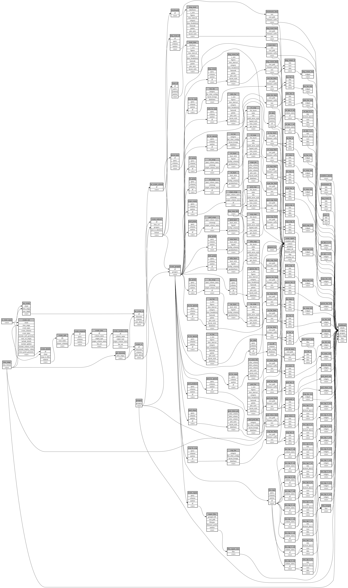

```
# AUTOGENERATED BY ECOSCOPE-WORKFLOWS; see fingerprint in README.md for details

```

```yaml
# fingerprint:
artifacts_sha256_basic: 7908489f5f114d5b69cc312d2c5164f5b2d621b14dff0a8572b104896be91a56
artifacts_sha256_strict: ec58dcc72dbae9ebb1a231a25909844d9454225210b51038114aab6a8450009a
installed_requirements:
- channel: https://repo.prefix.dev/ecoscope-workflows/
  name: ecoscope-platform
  version: {version: ==2.28.0}
- channel: https://repo.prefix.dev/ecoscope-workflows-custom/
  name: ecoscope-workflows-ext-custom
  version: {version: ==0.1.5}
- channel: conda-forge
  name: pydeck
  version: {version: ==0.9.2}
- channel: https://repo.prefix.dev/ecoscope-workflows-custom/
  name: ecoscope-workflows-ext-wd
  version: {version: ==0.0.14}
params_sha256: ec3fde93747834a9548ef13ed78cf43bbd2eb4d0add8d5f1b3e2482fe5d7d361
spec_sha256: 39194ed3cc15ba04a2ca57cc1bb56ae28cc015d423bffe4951d45c8b22481bf8

```

# ecoscope-workflows-nl-hwc-report-workflow


