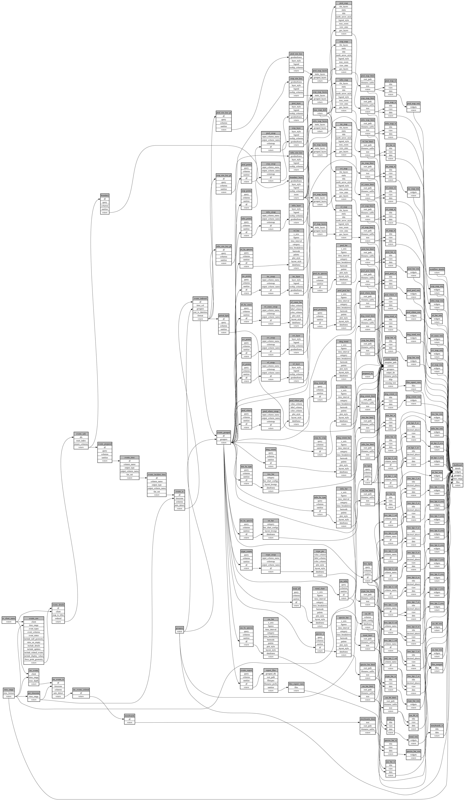

```
# AUTOGENERATED BY ECOSCOPE-WORKFLOWS; see fingerprint in README.md for details

```

```yaml
# fingerprint:
artifacts_sha256_basic: 333b2ad1bf9c500ec8334c7321b781fd0d947245c9c0bcf1dd8d06d29e259aac
artifacts_sha256_strict: 1027cff0d16f1761b564b3ea52e702ec307f103ba60d51a57da80831d9905908
installed_requirements:
- channel: https://repo.prefix.dev/ecoscope-workflows/
  name: ecoscope-platform
  version: {version: ==2.28.0}
- channel: https://repo.prefix.dev/ecoscope-workflows-custom/
  name: ecoscope-workflows-ext-custom
  version: {version: ==0.1.5}
- channel: conda-forge
  name: pydeck
  version: {version: ==0.9.2}
- channel: https://repo.prefix.dev/ecoscope-workflows-custom/
  name: ecoscope-workflows-ext-wd
  version: {version: ==0.0.14}
params_sha256: 8fc4a0fe2f3d7ed662cae74fbe1d3239385b9b4189c2d52f87c126f053ec122b
spec_sha256: 5258e65f2a66dc109556c9fe32e9c24f4445fab6b1ff61dbc6a83dcc807f1d46

```

# ecoscope-workflows-nl-hwc-report-workflow


